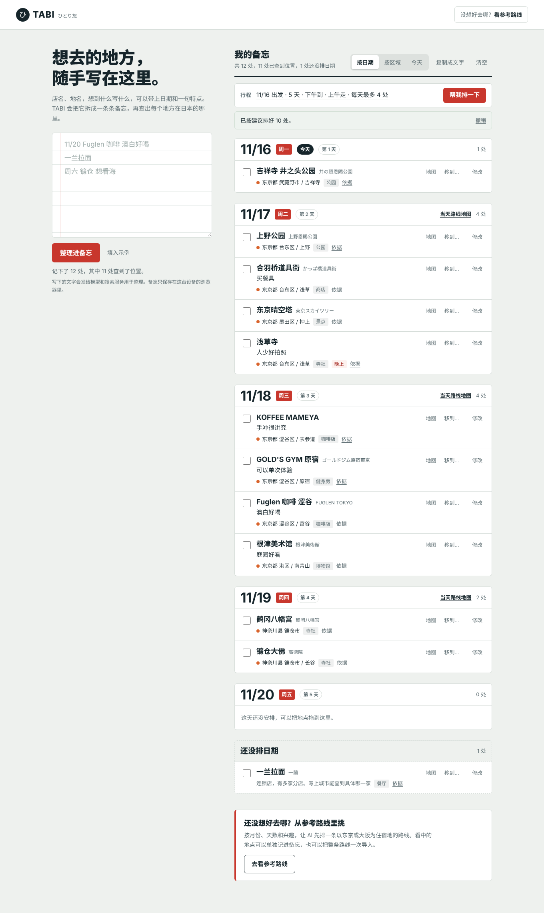
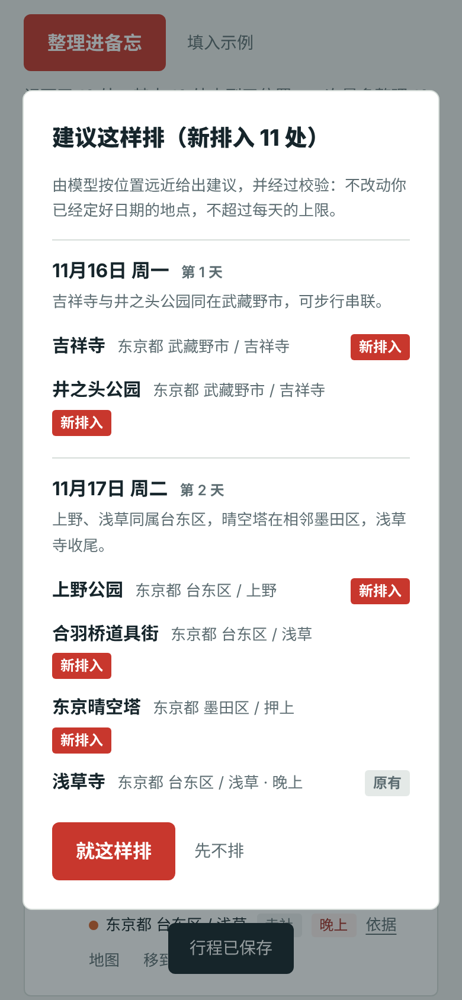
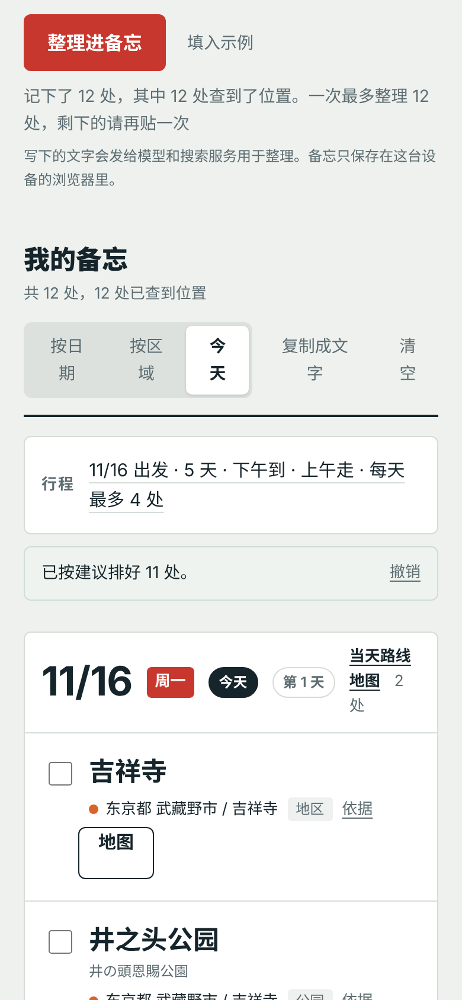

# TABI — 日本旅行备忘

把从小红书、朋友那里攒下来的店名和地名，整理成一份知道"每处在哪、哪天去、怎么排"的旅行备忘。只做日本。

**在线体验**：https://tabi-memo.shao-tabi.workers.dev

> **In short (English).** TABI turns the scattered place names a traveller collects from social media into a trip memo for Japan. You paste or type what you jotted down; it splits the text into places, looks up where each one is, groups them by day and district, and proposes a day-by-day arrangement you can accept, adjust or undo. It started as an "AI plans your route" tool and was redesigned after I noticed I never used it myself: my real habit was collecting places first and arranging them in my head. Built by Shao Tianzhuo as a personal project; product direction and decisions are mine, and most of the code was written with AI coding assistants (Claude and Codex).

<p>
  
  
  
</p>

## 为什么是"备忘"，不是"AI 规划路线"

这个项目的第一个版本是常见的做法：选城市、天数和兴趣，AI 生成一条路线。做完之后我发现自己出门时从来不用它。

回头看我真实的做法是这样的：

1. 在小红书刷到想去的店和地方，记进脑子或手机备忘录。只记名字和日期，店多的时候加一句特点，比如"澳白好喝"，不然名字和印象对不上。
2. 到了当地，或者出发前，在脑子里排哪天去哪。同一片的放一起，具体几点去看天气和心情。

也就是说，我不缺"去哪"的灵感，小红书在这件事上比任何 AI 推荐都强。我缺的是把零散的记录**整理**好、**排**出来。原来的产品把流程做反了：它假设用户没有想法，替用户做决定。

所以现在的 TABI 接住的是"从小红书到备忘录"这一步：

| 步骤 | 你做什么 | TABI 做什么 |
| --- | --- | --- |
| 记 | 随手写或粘贴，一行一条或一整段都行 | 拆成一条条备忘，保留你的原话作为特点 |
| 查 | 不用做 | 联网确认每处在哪个县、市、街区，附资料来源 |
| 排 | 说一共几天，愿意的话写上每晚住哪 | 把同一片的排到同一天、排到住处附近的日子，给出理由，确认后才生效 |
| 调 | 拖动，或点"挪过去" | 提醒哪天太满、哪天跨了县 |
| 带走 | 手机上打开 | 当天清单、地图跳转、在谷歌地图里搜附近的吃喝、勾选去过了 |

原来的"AI 生成参考路线"保留为次要入口，给还没有想法的人用。路线里看中的地点可以单独记进备忘，也可以整条导入。

## 几个设计取舍

**时段是可选的。** 我自己只定哪天去，不定几点。但很多人习惯分上午下午，所以写了"晚上"才标，不写就不标，也不会替你猜。

**不替用户挑。** "一兰拉面"有很多家分店，没写城市时标为"连锁店，写上城市能查到具体哪家"，而不是随便定位到某一家。不在日本的地点、查不到的地点也原样留着并说明，不会硬套到日本某处。

**编排是建议，不是结果。** 先出预览，每天附一句位置理由，新排入的和原有的分开标。已经定了日期的地点不会被挪动，整份编排可以一键撤销。

**不做的事。** 真实路程和时间、营业时间、定休日、预约，都没有做。这些需要地图和商户数据，成本和可靠性都不适合一个个人项目。每天提供一个地图链接，把当天的地点连起来，路程交给地图去算。

## AI 负责什么，代码负责什么

这个项目里我最在意的一条原则是：**模型负责需要理解和常识的部分，代码负责不能出错的部分，并且每一步都有不依赖模型的兜底。**

| 环节 | 模型做的 | 代码做的 | 模型不可用时 |
| --- | --- | --- | --- |
| 拆分文字 | 认出地点、特点、类型，给出日文搜索词 | 日期和时段由规则读取并覆盖模型的结果；原文里找不到的名称丢弃，防止编造 | 按行拆分，规则认日期 |
| 查位置 | 从搜索结果里读出县、市、街区 | 名称必须出现在所引用的资料里；县必须是日本的都道府县；屏蔽无关站点 | 标为"还没查位置"，其余功能照常 |
| 编排 | 判断哪些区相邻、哪些该同一天，写理由 | 不动已定日期的条目、不超每天上限；不排到离住处远的日子、不把不相邻的县放在同一天；模型把大组放到排不下的日子时重新对位；漏排的用规则补上；结果不如规则版就退回规则版 | 规则版：同一个市或区（京都、大阪按片区）放一天 |

几个在测试中发现、然后用代码而不是提示词解决的问题：

- 模型会把一段话里靠前的"下午"顺延到后面所有地点上。改为只认紧挨在名称前面那一小句里的时段词。
- 模型常把 4 处塞进只排得下 2 处的到达日。它分的"组"是对的，只是放错了天，所以加了一步：按组的大小重新对到容量合适的日子，出城的一日游优先挑整天。
- 早期的校验要求来源必须是政府或评价平台域名，结果咖啡店类查询几乎全被过滤掉。改为"屏蔽无关站点，其余按可信度分级"，同时要求店名必须真的出现在资料里。

## 怎么验证的

三套用真实模型和搜索跑的评测，加上不联网的自动测试。评测规模很小，只能说明"在这些例子上能用"，不能说明整体准确率。

| 评测 | 内容 | 结果 |
| --- | --- | --- |
| 联网发现 | 11 个查询（含 2 个事先留出、不针对它们调整的） | 修复前通过 4 个；修复后多数轮次通过 10–11 个 |
| 备忘整理 | 5 组输入共 22 处，含编造的店名、不在日本的地点、连锁店 | 多轮全部通过 |
| 编排 | 3 个带标准答案的行程（同区应同天、跨县应分开、已定日期不动、不超上限） | 多轮全部通过；约三分之二采用模型建议，其余退回规则版 |

不联网的测试：62 个单元测试，覆盖日期解析、地名归一、校验规则、规则编排（含住处与县的远近），以及限流、每日联网额度、每日 AI 次数和位置缓存。

已知的不足：

- 评测只检查数量和地理位置，不检查"推荐得好不好"。
- 模型输出每次不同，同一输入的结果会有波动。
- 没有坐标，同一天内的先后只按时段和"同区挨在一起"，不是最短路线。
- 备忘存在浏览器里，换设备不互通，也不能分享给别人。

## 技术实现

- **前端**：原生 HTML、CSS、JavaScript，没有框架和构建依赖。手机优先。
- **后端**：一个 Cloudflare Worker，五个接口。
- **模型**：DeepSeek，JSON 输出。
- **搜索**：Tavily。
- **存储**：备忘在浏览器的 localStorage；位置缓存和每日额度计数在 Cloudflare KV。
- **公开部署的保护**：每个 IP 每分钟 20 次请求；所有访客每天合计的联网搜索次数和模型调用次数各有上限，模型次数用完后各功能退回规则版；同一个"名称 + 城市"查过一次缓存 30 天。

| 接口 | 用途 |
| --- | --- |
| `POST /api/collect` | 把一段文字拆成备忘条目 |
| `POST /api/locate` | 联网确认每个地点的位置 |
| `POST /api/arrange` | 把未排日期的地点分到各天 |
| `POST /api/plan` | 生成参考路线（次要入口） |
| `POST /api/discover` | 联网寻找目的地或具体场所（参考路线页） |

## 项目结构

```text
web/index.html, home.css, home.js      备忘首页
web/classic.html, style.css, app.js    参考路线页
web/memo-example.js                    首页“看一个例子”的内置数据
shared/memo.js                         日期解析、本地拆分、规则编排；浏览器和 Worker 共用
worker/runtime.js                      服务端全部逻辑
data/catalog.json                      参考路线页的基础地点库
scripts/                               构建、测试、评测、本地服务
wrangler.jsonc                         Cloudflare 部署配置
HANDOFF.md                             更详细的开发记录与交接说明
```

## 本地运行

需要 Node.js 18 或以上，没有 npm 依赖。

```bash
npm run build         # 打包
npm test              # 全部不联网的测试
npm run dev           # 启动 http://localhost:8787
```

`npm run dev` 从环境变量读取 `DEEPSEEK_API_KEY` 和 `TAVILY_API_KEY`。没有密钥也能打开页面：拆分走本地规则，编排走规则版，查位置不可用。

三套真实评测会产生模型和搜索费用：

```bash
npm run eval          # 联网发现
npm run eval:memo     # 备忘整理
npm run eval:arrange  # 编排（没设密钥时只评测规则版）
```

## 部署

Cloudflare 的 Workers Builds 连接了这个仓库：合并到 `main` 后自动构建并部署。

第一次在新账号上部署，或需要手动部署时：

```bash
npx wrangler login
npx wrangler deploy --secrets-file .env.secrets   # 第一次：带上两把密钥
npm run deploy                                     # 之后手动部署
```

`.env.secrets` 是两行 `名称=值`，部署后删除。密钥不要写进仓库。

## 关于这个项目

个人项目，作者邵天卓（Shao Tianzhuo）。

- **我做的**：发现原产品的问题并决定改方向；定义新的产品流程和取舍；每个阶段的试用和反馈；部署。
- **AI 做的**：绝大部分代码、测试和评测脚本由 AI 编程助手编写。最初版本用 Codex，改版用 Claude。
- **来源**：参考路线页的地点库是人工整理的公开资料；两张城市照片来自 Wikimedia Commons，署名见该页面底部。
